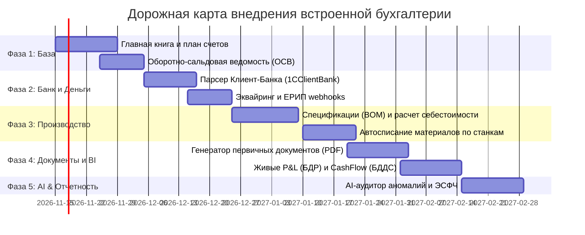

# Архитектурный план: Встроенная бухгалтерия и финансовый учет в CRM/ERP («Magi Finance»)

> **Цель проекта:** Полный отказ от внешних коннекторов к 1С и создание встроенного, сверхбыстрого модуля бухгалтерского и управленческого учета прямо в ядре CRM/ERP.  
> **Бизнес-контекст:** ООО «Фотопринт» / PicPac (производство фотокниг и полиграфии, 400 000 заказов/год, короткий цикл 1 день, BYN, рынок Беларуси и СНГ).  
> **Ключевой эффект:** Сокращение времени формирования отчетов с 3–4 часов (в 1С) до **< 100 миллисекунд** в режиме реального времени, отсутствие рассинхронизации данных, автоматическое формирование проводок по событиям производства и доставки.

---

## 1. Почему отказ от 1С-коннекторов неизбежен («Анатомия боли»)

1. **Проблема «Двойной правды» и рассинхронизации:**
   - При использовании 1С-коннекторов данные дублируются: заказ рождается в CRM, по API/файлам выгружается в 1С, там проводится, а затем статусы оплат и отгрузок возвращаются обратно.
   - Любой сбой сети, конфликт блокировок таблиц в 1С или изменение номенклатуры приводит к рассинхрону. В 1С заказ оплачен, в CRM — «висит неоплаченным», производство простаивает.
2. **Катастрофическая задержка отчетов (3–4 часа вместо онлайна):**
   - 1С построена на тяжелых регистрах накопления и бухгалтерии. Формирование сквозного отчета по себестоимости и БДДС на базе 100 000+ проводок подвешивает сервер и занимает часы.
   - Руководитель не видит кассовые разрывы и маржинальность заказа в момент его печати на станке.
3. **«Правка на пять минут требует 1С-программиста на неделю»:**
   - Изменение схемы распределения эквайринговой комиссии или ввод нового типа скидки требует доработки конфигурации 1С, обновления правил конвертации данных (КД 2.0/3.0) и релиза.
4. **Стоимость лицензий и инфраструктуры:**
   - Сервер 1С:Предприятие, клиентские лицензии на 50+ рабочих мест, лицензии MS SQL/PostgreSQL, поддержка франчайзи обходятся в тысячи долларов в год без прямой бизнес-отдачи.

---

## 2. Ключевые архитектурные принципы нативной бухгалтерии

```
┌─────────────────────────────────────────────────────────────────────────────┐
│                          СОБЫТИЙНЫЙ СЛОЙ CRM / ERP                         │
│  [Оплата на сайте]      [Печать на станке]        [Выдача в ПВЗ / Курьер]   │
└──────────────────────────────────────┬──────────────────────────────────────┘
                                       │ Real-time Event
                                       ▼
┌─────────────────────────────────────────────────────────────────────────────┐
│                  ACCOUNTING DISPATCHER (Движок авто-проводок)                │
│            Сопоставление бизнес-события с правилом бухгалтерского учета     │
└──────────────────────────────────────┬──────────────────────────────────────┘
                                       │ Ledger Posting
                                       ▼
┌─────────────────────────────────────────────────────────────────────────────┐
│                DOUBLE-ENTRY GENERAL LEDGER (Главная книга)                  │
│   • Неизменяемый журнал (Immutable Append-Only)                             │
│   • Инвариант: SUM(Debit) == SUM(Credit)                                    │
│   • Сторно вместо удаления (Storno-only audit trail)                        │
└──────────────────────────────────────┬──────────────────────────────────────┘
                                       │ Instant Sub-second Queries
                                       ▼
┌─────────────────────────────────────────────────────────────────────────────┐
│                    РЕАЛЬНОЕ ВРЕМЯ (Финансовый дашборд)                      │
│   [ОСВ за 50 мс]      [P&L / БДР на лету]      [Cash Flow / БДДС онлайн]   │
└─────────────────────────────────────────────────────────────────────────────┘
```

1. **Двойная запись (Double-Entry Bookkeeping) из коробки:**
   - Каждая финансовая операция состоит из сбалансированных проводок: Дебет одного счета = Кредит другого счета.
   - Сумма дебетов всегда равна сумме кредитов. Ошибка баланса невозможна на уровне схемы БД (CHECK/Trigger).
2. **Неизменяемость проводок (Immutable Append-Only Ledger):**
   - Проводки нельзя редактировать или удалять через `UPDATE` / `DELETE`.
   - Любая ошибка исправляется корректирующей операцией (красное сторно или обратная проводка) с указанием основания и автора.
3. **Связка с первичными объектами (Sub-ledger integration):**
   - Каждая проводка жестко привязана к `order_id`, `client_id`, `machine_id` или `counterparty_id`. Провал от баланса до конкретной фотокниги — в 1 клик.
4. **План счетов (Chart of Accounts, стандарт РБ/ЕАЭС):**
   - **50** — Касса компании (наличные, точки самовывоза).
   - **51** — Расчетные счета в банках (BYN, RUB, USD).
   - **57** — Переводы в пути (интернет-эквайринг, ЕРИП, наложенные платежи до зачисления).
   - **60** — Расчеты с поставщиками (бумага, картон, клей, клик-контракт HP Indigo).
   - **62** — Расчеты с покупателями и заказчиками.
   - **10** — Материалы на складе (бумага в рулонах/пачках, расходники).
   - **20** — Основное производство (прямая себестоимость тиражей).
   - **26** — Общехозяйственные расходы (аренда, офис, софт).
   - **43** — Готовая продукция (собранные фотокниги на складе отгрузки).
   - **90.1** — Выручка от реализации.
   - **90.2** — Себестоимость продаж.
   - **90.7** — Расходы на доставку и эквайринг.
   - **68** — Расчеты по налогам и сборам (НДС 20%).

---

## 3. Схема данных встроенной бухгалтерии (Core Data Model)

```sql
-- 1. План счетов
CREATE TABLE acc_accounts (
    code TEXT PRIMARY KEY,             -- '51.1', '62.1', '90.1'
    name TEXT NOT NULL,
    type TEXT NOT NULL CHECK (type IN ('asset', 'liability', 'equity', 'revenue', 'expense')),
    is_active INTEGER NOT NULL DEFAULT 1,
    parent_code TEXT REFERENCES acc_accounts(code)
);

-- 2. Хозяйственные операции (Транзакции)
CREATE TABLE acc_transactions (
    id INTEGER PRIMARY KEY AUTOINCREMENT,
    number TEXT NOT NULL UNIQUE,       -- 'TR-2026-000124'
    doc_type TEXT NOT NULL,            -- 'order_payment', 'shipment', 'bank_statement', 'material_writeoff'
    doc_id TEXT,                       -- ID связанного заказа/накладной
    date TEXT NOT NULL,                -- ISO-8601 YYYY-MM-DD
    description TEXT NOT NULL,
    is_posted INTEGER NOT NULL DEFAULT 1,
    storno_of_id INTEGER REFERENCES acc_transactions(id),
    created_by INTEGER REFERENCES users(id),
    created_at TEXT NOT NULL
);

-- 3. Проводки (Двойная запись)
CREATE TABLE acc_entries (
    id INTEGER PRIMARY KEY AUTOINCREMENT,
    transaction_id INTEGER NOT NULL REFERENCES acc_transactions(id) ON DELETE RESTRICT,
    account_debit TEXT NOT NULL REFERENCES acc_accounts(code),
    account_credit TEXT NOT NULL REFERENCES acc_accounts(code),
    amount REAL NOT NULL CHECK (amount > 0),
    currency TEXT NOT NULL DEFAULT 'BYN',
    -- Аналитические субконто для детализации
    counterparty_id INTEGER REFERENCES counterparties(id),
    client_id INTEGER REFERENCES clients(id),
    order_id INTEGER REFERENCES orders(id),
    cost_center TEXT,                  -- 'цех_печати', 'доставка', 'маркетинг'
    note TEXT NOT NULL DEFAULT ''
);

-- 4. Первичные документы (Счета, Акты, ТТН, Чеки)
CREATE TABLE acc_documents (
    id INTEGER PRIMARY KEY AUTOINCREMENT,
    kind TEXT NOT NULL CHECK (kind IN ('invoice', 'act', 'ttn', 'cash_receipt', 'esfch')),
    number TEXT NOT NULL,
    date TEXT NOT NULL,
    order_id INTEGER REFERENCES orders(id),
    counterparty_id INTEGER REFERENCES counterparties(id),
    total_amount REAL NOT NULL,
    vat_amount REAL NOT NULL DEFAULT 0,
    status TEXT NOT NULL DEFAULT 'draft' CHECK (status IN ('draft', 'issued', 'signed', 'cancelled')),
    file_path TEXT,                    -- Сгенерированный PDF / XML
    created_at TEXT NOT NULL
);

-- 5. Банковские выписки (Импорт без 1С)
CREATE TABLE acc_bank_statements (
    id INTEGER PRIMARY KEY AUTOINCREMENT,
    statement_date TEXT NOT NULL,
    account_number TEXT NOT NULL,
    opening_balance REAL NOT NULL,
    closing_balance REAL NOT NULL,
    total_inflow REAL NOT NULL,
    total_outflow REAL NOT NULL,
    raw_hash TEXT NOT NULL UNIQUE,     -- Защита от повторного импорта одного файла
    imported_at TEXT NOT NULL
);
```

---

## 4. Пошаговый план реализации встроенной бухгалтерии

> **Статус реализации (12.11.2026, демо для хакатона):**
> - ✅ Этап 1 полностью: план счетов (15 счетов), двойная запись с проверкой баланса до записи, сторно вместо удаления, ОСВ за период, типовые проводки (оплата/выручка/себестоимость/материалы/комиссия эквайринга), авто-разнесение по завершённым заказам + периодические операции месяца.
> - ✅ Этап 2 частично: парсер 1CClientBankExchange, дедуп по хэшу файла, авто-матчинг оплат по номеру заказа с разнесением Дт 51 — Кт 62; статус «требует уточнения» для платежей без сопоставления. ⏸ Вебхуки шлюзов/ЕРИП и генерация платёжек — после хакатона.
> - 🟡 Этап 3 упрощённо: без BOM-таблиц — материалы списываются нормативом 55% от себестоимости заказа; зарплата цеха и амортизация начисляются месячными проводками (Дт 20 Кт 70 / Кт 02).
> - 🟡 Этап 4 частично: счёт/акт/ТН-2 генерируются как печатные HTML-формы (печать в PDF из браузера), акт сверки в 1 клик. ⏸ QR-коды, штрихкоды, ЭСФЧ по порталу vat.gov.by — после хакатона.
> - ✅ Этап 5 частично: живые P&L (БДР) и Cash Flow (БДДС) помесячно чистым SQL, aging дебиторки/кредиторки по срокам. ⏸ Прогноз кассовых разрывов и авто-напоминания должникам.
> - ✅ Этап 6 частично: Magi Auditor ловит отрицательную маржу, зависший эквайринг (>3 дней на сч. 57) и задвоенные оплаты. ⏸ Диалоговый ассистент на естественном языке.
> Код: `server/accounting.py`, UI: страница «Бухгалтерия» (вместо 1С-страницы), тесты: `test_accounting_*`.

### ЭТАП 1: Ядро двойной записи и Главная книга (Core Ledger Engine)
- [ ] **1.1. Модель данных и миграции:**
  - Создать таблицы `acc_accounts`, `acc_transactions`, `acc_entries` с жесткими внешними ключами и ограничениями целостности.
  - Наполнить базовый план счетов (рабочий план счетов полиграфического e-commerce: касса, банк, расчеты с покупателями, себестоимость, выручка, налоги).
- [ ] **1.2. Транзакционный сервис `LedgerService`:**
  - Реализовать атомарное создание хозяйственных операций с автоматической валидацией баланса Дебет = Кредит.
  - Механизм аннулирования: создание зеркальной сторно-транзакции (`storno_of_id`) без физического удаления записей.
- [ ] **1.3. Сервис Оборотно-сальдовой ведомости (ОСВ):**
  - Оптимизированный SQL-запрос для построения ОСВ за любой диапазон дат (начальное сальдо, дебетовый оборот, кредитовый оборот, конечное сальдо).
  - Время выполнения: < 30 мс на 500 000 строк проводок благодаря составным индексам `(account_debit, date)` и `(account_credit, date)`.
- [ ] **1.4. Шаблоны типовых проводок (Accounting Rules Dispatcher):**
  - Шаблон `ORDER_PAY_ONLINE`: Дт 57 (Эквайринг в пути) — Кт 62 (Клиент).
  - Шаблон `ORDER_DELIVERED`: Дт 62 (Клиент) — Кт 90.1 (Выручка) и Дт 90.2 (Себестоимость) — Кт 43 (Готовая продукция).
  - Шаблон `ACQUIRING_FEE`: Дт 90.7 (Комиссия) — Кт 57 (Эквайринг).

---

### ЭТАП 2: Казначейство, Банк и Эквайринг (Прямой импорт без 1С)
- [ ] **2.1. Встроенный парсер банковских выписок (`1CClientBankExchange` & ISO 20022):**
  - Парсер текстовых выписок Клиент-Банка (формат `.txt` стандартов банков РБ/РФ: Приорбанк, Альфа-Банк, Беларусбанк, Сбер).
  - Извлечение секций `СекцияРасчСчет` и `СекцияДокумент` (номер, дата, сумма, УНП/ИНН плательщика, назначение платежа).
- [ ] **2.2. Авто-распознавание и разнесение оплат (Reconciliation Engine):**
  - Интеллектуальный матчинг входящего платежа:
    1. Поиск номера заказа в назначении платежа (`#587`, `заказ 587`).
    2. Поиск контрагента по УНП / номеру договора.
    3. При совпадении суммы и реквизитов — автоматическое закрытие дебиторки (Дт 51 — Кт 62/60).
    4. При несовпадении — статус «Требует уточнения бухгалтера» с подсказкой ИИ.
- [ ] **2.3. Интеграция с платежными шлюзами и ЕРИП:**
  - Прямые вебхуки от интернет-эквайринга (bePaid, WebPay) и реестры платежей ЕРИП.
  - Автоматическое разделение поступившей суммы на чистое поступление на р/с и удержанную комиссию банка (например, 2.5%).
- [ ] **2.4. Выгрузка платежных поручений:**
  - Генерация исходящих платежек в формате Клиент-Банка для оплаты поставщикам материалов и услуг доставки в 1 клик.

---

### ЭТАП 3: Позаказный производственный учет себестоимости (Job Costing)
- [ ] **3.1. Технологическая карта фотопродукта (Bill of Materials / BOM):**
  - Спецификация нормы расхода на каждую фотокнигу:
    - Бумага блока (листов мелованной/фотобумаги).
    - Картон переплетный + переплетный клей.
    - Ламинация (глянец/софт-тач, погонные метры).
    - Клик-контракт печатной машины (HP Indigo: клики CMYK на оттиск).
- [ ] **3.2. Автоматическое списание материалов при печати:**
  - Событие ERP `machine_job.done` (печать тиража завершена) -> автоматическая проводка:
    - `Дт 20 (Основное производство) — Кт 10 (Склад бумаги и тонера)`.
- [ ] **3.3. Распределение сменной зарплаты и амортизации:**
  - Начисление сдельной оплаты операторов и сменной амортизации оборудования на партию заказов:
    - `Дт 20 (Производство) — Кт 70 (Расчеты по оплате труда)`.
    - `Дт 20 (Производство) — Кт 02 (Амортизация станков)`.
- [ ] **3.4. Выпуск продукции и списание в себестоимость:**
  - По факту сборки книги: `Дт 43 (Готовая продукция) — Кт 20 (Производство)`.
  - По факту вручения клиенту: `Дт 90.2 (Себестоимость продаж) — Кт 43 (Готовая продукция)`.
  - Результат: точная маржинальность каждого заказа до копейки в реальном времени!

---

### ЭТАП 4: Первичные документы, Счета и ЭДО (Документооборот)
- [ ] **4.1. Автогенерация B2B-документов (PDF на лету):**
  - Счёт на оплату с QR-кодом для быстрого платежа в мобильном банке.
  - Акт выполненных работ / оказанных услуг.
  - Товарная накладная (ТН-2) и товарно-транспортная накладная (ТТН-1) со штрихкодированием.
- [ ] **4.2. Акт сверки взаиморасчетов в 1 клик:**
  - Выбор контрагента и периода -> мгновенное формирование акта сверки с историей всех оплат, отгрузок и сальдо.
- [ ] **4.3. Интеграция с порталом ЭСФЧ (vat.gov.by) по НДС:**
  - Автоматическая генерация XML-файла электронного счета-фактуры по отгруженным заказам за месяц.
  - Пакетная валидация ставок НДС (20%) без ручного набивания в 1С.

---

### ЭТАП 5: Финансовая аналитика в реальном времени (Financial BI)
- [ ] **5.1. Отчет о прибылях и убытках (P&L / БДР) методом начисления (Accrual Basis):**
  - Выручка признается по факту передачи заказа, расходы — по факту списания материалов.
  - Чистая валовая маржа, операционная прибыль (EBITDA), чистая прибыль без задержек.
- [ ] **5.2. Отчет о движении денежных средств (Cash Flow / БДДС) кассовым методом:**
  - Прямой метод: Операционная деятельность (приход от клиентов — оплата поставщикам — зарплата — налоги) + Инвестиционная + Финансовая.
  - Прогноз кассовых разрывов на 4 недели вперед с учетом подтвержденных заказов.
- [ ] **5.3. Контроль дебиторской и кредиторской задолженности (Aging Report):**
  - Группировка долгов по срокам: до 7 дней, 8–14 дней, 15–30 дней, безнадежные.
  - Автоматические напоминания клиентам-должникам в Telegram и email.

---

### ЭТАП 6: AI-аудитор и ассистент бухгалтера («Magi Auditor»)
- [ ] **6.1. Автоматический поиск аномалий и ошибок учета:**
  - Выявление заказов с отрицательной маржинальностью (ошибка в расчете цены или перерасход материалов).
  - Поиск задвоенных оплат от одного контрагента.
  - Сигнализация о зависших остатках на счете 57 (эквайринг не перевел деньги в срок > 3 дней).
- [ ] **6.2. Диалоговый ассистент для финансового директора:**
  - Запросы на естественном языке: *«Какая чистая маржа по фотокнигам Premium за прошлую неделю?»*, *«Сколько мы должны поставщику бумаги "Балтик Папир"?»*.
  - Мгновенный ответ с ссылками на проводки-основания.

---

## 5. Сравнение подходов: 1С-Коннектор vs Встроенная Бухгалтерия

| Критерий оценки | Классический 1С-Коннектор | Встроенная бухгалтерия Magi |
|---|---|---|
| **Скорость формирования отчетов** | 3–4 часа (выгрузка, пересчет регистров) | **< 100 мс** (чистые SQL-агрегаты в реальном времени) |
| **Актуальность данных** | Пакетный обмен раз в час/сутки (отставание) | **0 секунд** (проводка создается в момент действия) |
| **Риск рассинхронизации** | Высокий (зависшие очереди, дублирование) | **0%** (единая база данных и общие ID) |
| **Стоимость владения (TCO)** | Лицензии 1С, сервер, программист 1С ($15 000+/год) | **$0** (встроено в собственный стек CRM/ERP) |
| **Изменение учетной политики** | Недели разработки и тестирования в 1С | Минуты (настройка правил в интерфейсе) |
| **Сквозной Drill-Down** | Невозможен (в 1С нет данных о станках и чатах) | От итоговой маржи до фотокниги и чата в 2 клика |

---

## 6. График и дорожная карта реализации (Roadmap)



---

## 7. Риски и стратегии их минимизации

1. **Риск изменения налогового законодательства и форм отчетности:**
   - *Минимизация:* Встроенная бухгалтерия решает 95% задач операционного и управленческого учета (первичка, банк, касса, себестоимость, сверки, P&L, CashFlow). Для сдачи годовой регламентированной декларации в налоговую формируется стандартизированный файл выгрузки или используется минимальная бухгалтерская база аутсорсера раз в квартал.
2. **Риск ошибок пользователей при ручном вводе:**
   - *Минимизация:* 90% проводок генерируются системой автоматически по триггерам бизнес-процессов (оплата заказа, завершение печати на станке, вручение курьером). Ручные проводки доступны только главному бухгалтеру и логируются в аудите.
3. **Надежность финансовых данных:**
   - *Минимизация:* Запрет физического удаления строк из журнала проводок (`DELETE RESTRICT`), регулярное создание снимков БД (WAL-архивация), математическая проверка равенства дебетовых и кредитовых оборотов перед каждым закрытием периода.
