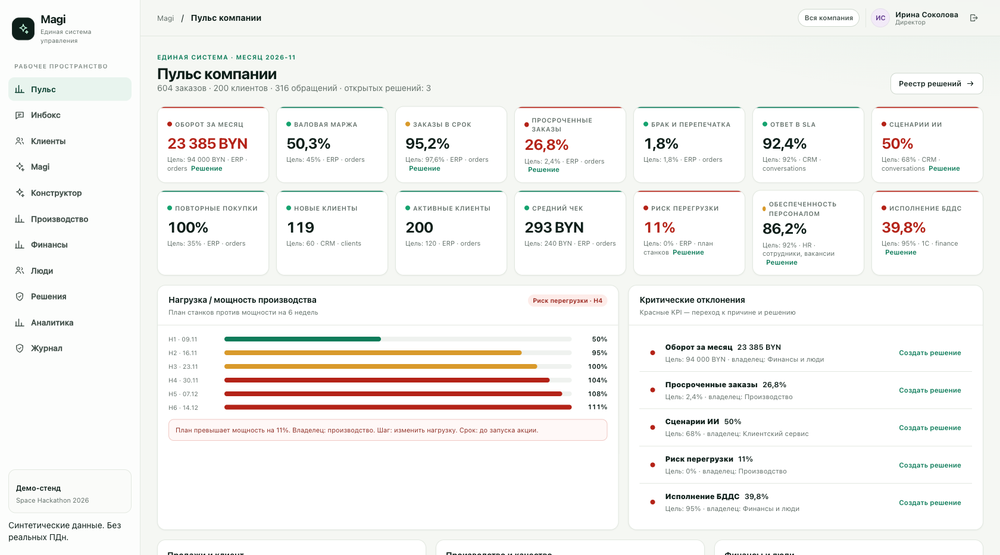
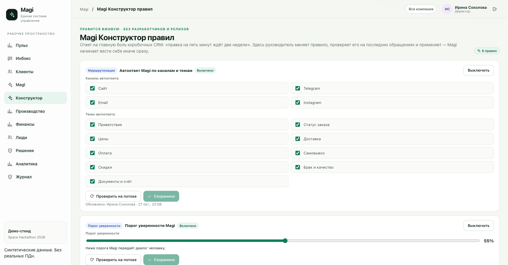
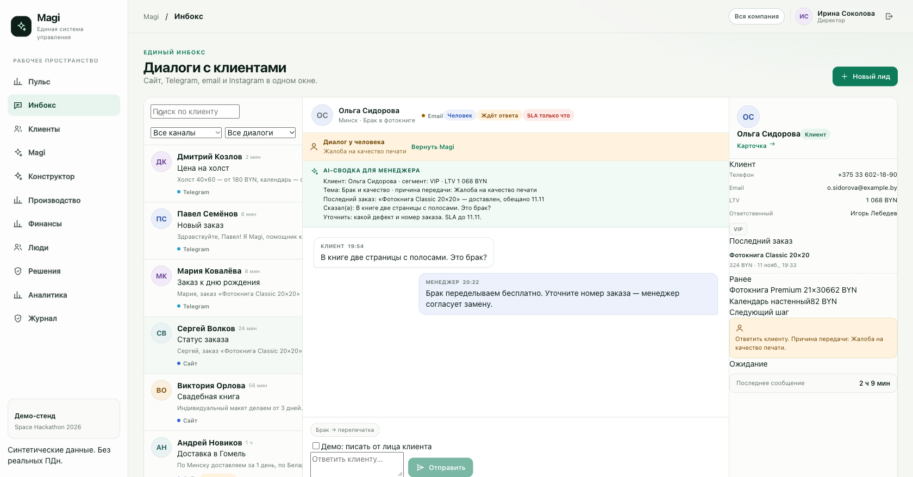

# Magi — единая система управления компанией

MVP для Space Hackathon 2026, трек 1 «Управленческая платформа» (заказчик — ООО «Фотопринт»).

Одно окно, которое объединяет **CRM, ERP/производство, 1С/финансы и HR** на общих
идентификаторах: пульс компании с KPI-паспортами, проваливание от цифры к причине,
реестр решений с проверяемым результатом и AI-ассистент **Magi** в едином инбоксе
обращений. Фишка против боли коробочных CRM — **Magi Конструктор правил**, где
руководитель меняет правило вживую и проверяет его на потоке без разработчиков и релизов.

## Сценарий трека 1 (УП-01…УП-05)

| Критерий | Как выполнен |
|---|---|
| УП-01 · ≥3 источника под общими ID | CRM (клиенты/обращения), ERP (заказы/станки), 1С (БДР/БДДС/операции), HR (штаб/смены) — связаны через `client_id`/`order_id` |
| УП-02 · ≥10 KPI с формулой и источником | 14 KPI-паспортов в реестре: формула, источник, цель, время обновления — на экране «Пульс» и в `/api/pulse` |
| УП-03 · фильтр меняет показатели, детализация объясняет отклонение | Период/подразделение на «Обзоре»; причины просрочки (доставка/модерация/производство) → заказы-основания → карточка решения |
| УП-04 · решение сохраняется и журналируется | Реестр решений: создание/изменение пишет `decision.create`/`decision.update` в аудит |
| УП-05 · руководитель не видит чужое | Роли на сервере: руководитель видит только свой отдел (`/api/finance`, `/api/production`, `/api/hr` проверяют команду) |

Объём данных (синтетика): **604 заказа, 200 клиентов, 316 обращений**, 17 тематик с SLA,
5 станков с очередями, 6 месяцев БДР/БДДС, 29 сотрудников, 14 KPI-паспортов, 6 правил Magi.

## Роли и доступ (проверяются на сервере)

| Роль | Email (пароль у всех `demo`) | Видит |
|---|---|---|
| Директор | `director@magi.by` | Пульс компании, все отделы, решения, журнал |
| Руководитель клиентского сервиса | `head.crm@magi.by` | Свой отдел: инбокс, клиенты, Magi, Конструктор правил |
| Менеджер | `manager@magi.by` | Только свои диалоги и клиенты |
| Руководитель производства | `head.production@magi.by` | Производство: станки, очереди, причины просрочки |
| Руководитель финансов и HR | `head.finance@magi.by` | Финансы (1С) и люди (HR) |
| Аналитик | `analyst@magi.by` | Пульс, качество данных, сверки (чтение) |

## Экраны

- **Пульс компании** — 14 KPI (оборот, маржа, в срок, просрочки, брак, SLA, сценарии ИИ,
  повторные, риск перегрузки…), статус-цвета против целей, 6-недельный график
  «нагрузка/мощность» (Н1…Н6, пик 111% → «риск перегрузки +11%»), критические отклонения
  с переходом в карточку решения.
- **Производство и качество** — план/факт выпуска, lead time, станки, очередь заданий,
  разбор просрочки по причинам → заказы-основания → владелец → действие.
- **Финансы (1С)** — БДР/БДДС план-факт по месяцам, маржа, дебет/кредит, контрагенты.
- **Люди (HR)** — штат по отделам, вакансии, отсутствие, смены (табелирование).
- **Реестр решений** — проблема → влияние → причина → действие → владелец → срок → статус
  → результат проверки; история — в журнале.
- **Аналитика источников** — свежесть CRM/ERP/1С/HR, пропуски и дубли, сверка
  финансовых итогов CRM ↔ ERP ↔ 1С.
- **Инбокс** — единая очередь сайт/Telegram/email/Instagram, чат, карточка клиента,
  SLA-таймер по теме, шаблоны в один клик, AI-сводка для менеджера при передаче,
  режим «писать от лица клиента», передача человеку и возврат Magi, напоминания о заказах в ПВЗ.
- **Magi** — метрики, база знаний, маскирование ПДн перед отправкой в модель.
- **Magi Конструктор правил** — маршрутизация, порог уверенности, триггеры передачи,
  SLA-эскалация, напоминания: правка вживую + «Проверить на потоке» на 120 последних
  обращениях (было/станет + примеры) + применение без перезапуска.
- **Журнал** — кто, когда и что сделал (входы, решения, правила, передачи, напоминания).





## Быстрый старт (≤15 минут)

Нужны Python 3.12+ и Node.js 20+.

```bash
python3 -m venv .venv
.venv/bin/pip install -r server/requirements.txt

cd web && npm install && npm run build && cd ..

.venv/bin/uvicorn server.app:app --host 127.0.0.1 --port 8000
```

Откройте http://127.0.0.1:8000 — SQLite создастся и заполнится синтетикой при первом запуске.
Сброс: `rm -f data/magi.db` или директором через `POST /api/demo/reset`.

Telegram-бот (aiogram 3), интегрированный с той же CRM:

```bash
# .env в корне проекта: MAGI_TELEGRAM_TOKEN=... (токен не хранится в репозитории)
# .env читается автоматически и веб-приложением, и ботом
.venv/bin/python -m server.telegram_bot
```

Входящие сообщения → клиент и диалог в инбоксе → ответ Magi (тот же движок и правила).
Ответ менеджера из CRM на telegram-диалог уходит клиенту через исходящую очередь `tg_outbox`.
Передача человеку работает как в инбоксе: диалог забирает менеджер вместе с AI-сводкой.

Разработка фронтенда: `uvicorn server.app:app --reload` + `cd web && npm run dev`
(порт 5173, `/api` проксируется).

## Демо на 5–7 минут

1. **Директор → Пульс.** 14 KPI с формулами; красные: «Просроченные заказы», «Риск перегрузки 11%».
   График Н1…Н6 — перегрузка на Н4–Н6 из-за акции к 14 ноября.
2. **Провал к причине.** «Производство» → причины просрочки (доставка 54% / модерация 26% /
   производство 20%) → «Заказы-основания» → конкретные заказы и ответственные.
3. **Решение.** Из критического отклонения «Создать решение» → карточка (проблема, влияние,
   причина, действие, владелец, срок) → статус «В работу». Журнал фиксирует.
4. **Magi Конструктор.** Руководитель клиентского сервиса меняет порог уверенности,
   жмёт «Проверить на потоке» — видно, сколько обращений станет автоответами, и примеры.
   «Применить» — Magi сразу ведёт себя иначе. Без релиза.
5. **Инбокс.** Диалог Марии: «Демо: писать от лица клиента» → «Успеет ли фотокнига к 14 ноября?»
   → Magi отвечает по заказу из ERP (статус, срок, уверенность). Шаблон в один клик.
   Новый лид с жалобой → Magi передаёт человеку и показывает **AI-сводку для менеджера**.
6. **Финансы и люди.** БДР/БДДС план-факт, контрагенты, штат/вакансии, отсутствие.
7. **Аналитика.** Свежесть источников, сверка CRM ↔ 1С (расхождение ~2% объяснено).
8. **Другая роль.** Вход руководителем производства: чужие отделы закрыты на сервере (УП-05).

## Архитектура

```text
React 19 + Vite (SPA)
      │  fetch /api · HttpOnly cookie-сессия (HMAC)
      ▼
FastAPI ──────────────── роли: director / head / operator / analyst
      │                   client_scope / conversation_scope / require_teams
      ▼
SQLite (23 таблицы, stdlib sqlite3, без ORM)
  ├─ CRM:      clients, conversations, messages, tasks, templates, topics, pickups
  ├─ ERP:      orders, machines, machine_jobs
  ├─ 1С:       finance_periods, finance_entries, counterparties
  ├─ HR:       hr_employees, vacancies, shifts
  └─ Управление: kpi_registry, decisions, rules, audit, settings, users, kb
      ▼
Magi: локальный движок правил (по умолчанию, офлайн)
      или OpenAI-совместимый /chat/completions с динамическими промптами:
      тема → свой системный промпт + минимальный срез контекста
      (server/prompts.py; маска ПДн; история только для «болтливых» тем)
```

- Один процесс: прод-сборка SPA раздаётся FastAPI (`app.frontend`), без CDN и внешних шрифтов.
- Правила Magi хранятся в БД и читаются на каждом сообщении — правка применяется мгновенно.
- ПДн маскируются перед любым обращением к внешней модели (телефоны, почта, инициалы).
- Даты — ISO с UTC; деньги — BYN; формулы KPI — в реестре (`kpi_registry`).

## Magi: логика ответов

По умолчанию офлайн-движок: интенты → ответы по данным клиента/заказов/базы знаний;
проверка просроченного обещания; передача человеку по триггерам (жалоба, возврат,
персональные условия, просьба позвать менеджера) или при уверенности ниже порога.
Опционально — OpenAI-совместимый провайдер:

```bash
export MAGI_BASE_URL=https://api.openai.com/v1
export MAGI_API_KEY=sk-...
export MAGI_MODEL=gpt-4.1-mini
```

Провайдер получает ответ и при ошибке Magi откатывается на локальный движок.

### Динамические промпты (под маленькие LLM)

Тема обращения определяется **локальным классификатором** (без LLM), поэтому модель
получает не один огромный промпт, а короткий промпт своей задачи (`server/prompts.py`,
17 тем) и только нужный срез контекста: теме «Статус заказа» — один последний заказ,
темам про цены — только прайс, теме «Приветствие» — заметки о клиенте (день рождения,
события). История диалога включается только для «болтливых» тем. Это даёт работу с
моделями 7B-класса без раздувания контекста: ~600–900 токенов на запрос.

### Алгоритм развития ИИ (по ходу работы CRM)

Замкнутый контур «измерить → предложить → человек подтверждает → Magi растёт»
(экран «Magi → Развитие Magi», `GET /api/agent/learning`):

1. **Измеряем** принятость автоответов по темам: диалог закрыт Magi и клиент не вернулся
   с новым вопросом в течение 48 часов. Ниже 70% — тема кандидат на передачу человеку.
2. **Предлагаем** правило: частая причина передачи («Индивидуальный макет» ×N) →
   триггер-правило в Конструктор одним кликом.
3. **Предлагаем** статью базы знаний: популярный ответ менеджера по теме, которой ещё
   нет в БЗ, → «В базу знаний» одним кликом (как дообучение в кейсе Mary, только
   управляемое и прозрачное).
4. Каждое применение пишет `kb.grow` / `rules.create` в аудит — история развития Magi
   воспроизводима.

## Переменные окружения

| Переменная | По умолчанию | Назначение |
|---|---|---|
| `MAGI_DB` | `./data/magi.db` | путь к SQLite |
| `MAGI_SECRET` | демо-значение | подпись cookie-сессии |
| `MAGI_PASSWORD` | `demo` | пароль демо-ролей |
| `MAGI_SECURE_COOKIE` | `0` | `1` для HTTPS |
| `MAGI_CORS` | localhost:5173 | разрешённые origin для dev |
| `MAGI_BASE_URL` / `MAGI_API_KEY` / `MAGI_MODEL` | пусто | OpenAI-совместимый провайдер Magi |
| `DEMO_MODE` | `1` | разрешает сброс демо |

Шаблон — `.env.example`; файл окружения: `uvicorn ... --env-file .env`.

## API (основное)

| Метод и путь | Назначение |
|---|---|
| `POST /api/auth/login` · `GET /api/auth/me` | вход, текущий пользователь |
| `GET /api/dashboard` | дашборд скоупа роли |
| `GET /api/pulse` | пульс компании: 14 KPI + 6 недель мощности |
| `GET /api/sales` · `/api/production` · `/api/production/causes/{c}/orders` | продажи; производство и детализация причин |
| `GET /api/finance` · `/api/hr` | 1С-витрина; кадры |
| `GET /api/analyst` | свежесть, дубли, сверка |
| `GET/POST/PATCH /api/decisions` | реестр решений (журналируется) |
| `GET/PATCH /api/rules` · `POST /api/rules/test` | Конструктор правил и проверка на потоке |
| `GET /api/clients` · `/api/clients/{id}` | клиенты со скоупом роли |
| `GET /api/conversations` · `/{id}` · `POST /{id}/messages` · `/{id}/handoff` · `/{id}/resume` | инбокс |
| `POST /api/leads` | новый лид + первый ответ Magi |
| `GET /api/templates` · `GET /api/pickups` · `POST /api/pickups/{id}/remind` | шаблоны; ПВЗ и напоминания |
| `GET/PATCH /api/agent` | метрики и настройки Magi |
| `GET /api/agent/learning` · `POST /api/agent/learning/apply` | алгоритм развития ИИ |
| `POST /api/import/preview` · `/api/import/apply` | миграция клиентов из CSV/JSON (директор) |
| `GET /api/audit` · `POST /api/demo/reset` | журнал; сброс демо (директор) |

## Тесты

```bash
.venv/bin/python -m pytest -q server/tests
```

15 тестов: вход и роли, скоупы (оператор/руководитель/аналитик, запрет чужих отделов),
пульс и KPI-паспорта (УП-02), детализация причин (УП-03), создание и изменение решения
с аудитом (УП-04), ответ Magi по заказу, передача человеку и AI-сводка, шаблоны и
напоминание ПВЗ, Конструктор правил (тест на потоке, применение вживую, запрет для
оператора), маскирование ПДн, динамические промпты и срезы контекста, Telegram-диалог
создаёт клиента/диалог/ответ и передачу человеку с исходящей очередью, миграция CSV
(проверка → импорт → повторный импорт без дублей), алгоритм развития ИИ (БЗ и правила
растут из ответов менеджеров с аудитом).

## Известные ограничения

- Telegram интегрирован реально (aiogram 3, long polling). Email/Instagram/сайт — имитации
  в единой модели данных; коннекторы — следующий шаг пилота. Бот требует сеть: на площадке
  без интернета работает только веб-часть демо.
- Провайдер Magi — один вызов без tool-calling; качества реальной модели не проверяли.
- SQLite и один процесс — для демо и пилота, не для 300 сотрудников.
- Все данные синтетические; LTV, финансы и выручка — не фактические показатели компании.
- HR-сотрудники и клиенты — вымышленные ФИО без реальных ПДн.

## Документы

- `docs/ТЗ_Хакатон_Единая_система_управления_компанией.pdf` — ТЗ трека 1.
- `docs/CRM_системы_на_базе_искусственного_интеллекта_и_вытекающий_из_них.pdf` — кейс Mary.
- `docs/magi-presentation.md` — презентация (10 слайдов).
- `docs/space-hackathon-2026-plan-track1.md` — первоначальный план.

## Лицензия

MIT для кода. Данные — синтетические, распространяются вместе с демо.
