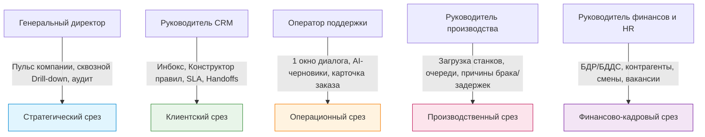

# Комплексный анализ CRM-системы, коробочных ограничений, бенчмарков и концепция пилота для хакатона

> **Проект:** Единая система управления компанией и клиентского сервиса («Magi» / «Завтра»)  
> **Заказчик:** Производственная e-commerce компания «Фотопринт» / PicPac (400 000 фотокниг в год, 1 день на производство, 300 сотрудников, 5 разрозненных систем)  
> **Цель документа:** Провести глубокий сравнительный анализ коробочных и готовых CRM, зарубежных AI-native систем, составить профиль пользователей, выявить недостающие функции текущей версии и спроектировать сценарий зрелищного пилота для защиты на хакатоне.

---

## 1. Анализ минусов коробочного решения (почему Битрикс24 и аналоги стали тормозом)

На основе транскрипций выступлений заказчика ([crm2.txt](file:///Users/skenls/vadarod-11.11/docs/crm2.txt), [crm-транскрипция-лекции.txt](file:///Users/skenls/vadarod-11.11/docs/crm-транскрипция-лекции.txt)), презентации [CRM_системы_на_базе_искусственного_интеллекта.txt](file:///Users/skenls/vadarod-11.11/docs/CRM_системы_на_базе_искусственного_интеллекта_и_вытекающий_из_них.txt) и архитектурного анализа e-commerce:

```
┌────────────────────────────────────────────────────────────────────────┐
│                        «Парадокс коробки»                              │
│                                                                        │
│   Обещание вендора:               Реальность на производстве:          │
│   «Всё включено из коробки,       «Правка на 5 минут требует недели    │
│    кликни и работай!»       ──►    разработки, интеграций и падает     │
│                                    под нагрузкой 1000+ заказов в день» │
└────────────────────────────────────────────────────────────────────────┘
```

### Ключевые проблемы коробочного решения для динамичного производства:

1. **«Правка на 5 минут занимает 2–3 недели» (Архитектурный монолит и вендор-лок):**
   - В Битрикс24 любая нестандартная бизнес-логика (например, динамический расчет загрузки печатных станков HP Indigo, проверка срока готовности фотокниги на 14 ноября или специфический сценарий валидации макетов) требует разработки кастомного модуля или громоздких роботов в дизайнере бизнес-процессов.
   - Каждое обновление коробки («Bitrix Update») грозит сломать кастомные хуки и переопределенные компоненты. Чтобы выкатить мелкую правку, бизнес вынужден содержать дорогих PHP/Bitrix-разработчиков, настраивать тестовый контур, проводить регрессионное тестирование.

2. **Критическая медлительность интерфейса (High Latency & UI Bloat):**
   - Битрикс24 тянет за собой сотни универсальных скриптов, стилей и компонентов (задачи, живая лента, диск, телефония, чаты, экстранет). 
   - Время открытия карточки сделки/клиента часто составляет **2.5–5 секунд**. Для оператора поддержки, обрабатывающего сотни обращений в день в сезон (ноябрь-декабрь), задержка в 3 секунды на каждом клике выливается в часы потерянного времени и раздражение клиентов.
   - Карточка перегружена десятками нерелевантных вкладок и полей, в которых менеджер вынужден бесконечно скроллить.

3. **Неприспособленность к транзакционному e-commerce и коротким производственным циклам:**
   - В традиционных CRM ключевая сущность — это долгая **«Сделка» (Deal)** в воронке продаж с этапами квалификации, КП, переговоров.
   - У «Фотопринта» и PicPac специфика принципиально иная: **транзакционный поток заказов со сроком исполнения 1 день (96–97% заказов)**. Здесь нет долгих переговоров — здесь критичен статус в цехе: *«заказ принят → файл проверен → очередь на печать → станок №2 → ламинация → сборка → ПВЗ/курьер»*. Попытка натянуть этот конвейер на «стадии сделки» Битрикса приводит к постоянным блокировкам базы данных и рассинхронизации.

4. **«Слепая аналитика» и сборка отчетов вручную по 3–4 часа:**
   - Как подчеркнул спикер в лекции: *«Чтобы сформировать отчет по взаиморасчетам и статусам в 1С/Битриксе, уходило 3–4 часа, и сотрудники считали, что это нормально»*.
   - Коробочные дашборды не умеют связывать сквозные идентификаторы (`client_id` + `order_id` + `machine_id` + `shift_id`). Руководитель видел агрегированные графики («просрочено 4%»), но не мог в два клика провалиться от красной цифры к конкретному станку, смене или клиенту.

5. **Невозможность оперативного управления AI-правилами без кода:**
   - В коробке AI (например, Bitrix CoPilot) встроен как универсальный ассистент для рерайтинга текста. Руководитель клиентского сервиса не может сам в реальном времени подкрутить порог уверенности (например, с 0.65 до 0.50), поменять правила маршрутизации жалоб и сразу протестировать изменение на потоке последних 100 диалогов без привлечения IT-отдела.

---

## 2. Анализ зарубежных решений CRM (Next-Gen AI & Speed Benchmarks)

Современный международный рынок CRM переживает смену парадигмы: от монолитных «систем хранения записей» (System of Record) к сверхбыстрым, гибким и агентским системам (System of Action / Headless & AI-Native CRM).

| Система | Архитектурный фокус | Сильные стороны | Скорость и UX | Применимость для нашего кейса |
|---|---|---|---|---|
| **Attio** (Next-gen CRM) | Real-time streaming, движок запросов на Rust, реляционные + неструктурированные данные | • Полная кастомизация объектов за секунды без кода<br>• Sub-100ms API<br>• Автоматический сбор контекста из писем и встреч | P95 < 80ms, мгновенный SPA интерфейс, похожий на Notion/Linear | **Высокая:** эталон скорости и гибкости структуры данных (клиенты ↔ заказы ↔ станки). |
| **Plain** (plain.com) | Support platform для быстрых B2C/B2B технологичных компаний | • Keyboard-first UX (полное управление без мыши)<br>• Live-карточки данных клиента через микросервисы компании<br>• Thread-based архитектура | Мгновенный отклик (<50ms), таймеры SLA в реальном времени, чистый фокус на тикете | **Высокая:** идеальный образец для рабочего места оператора поддержки (Инбокс). |
| **Gorgias** | E-commerce Customer Service платформа (лидер для Shopify) | • Глубокая интеграция с каталогом и складом<br>• Виджеты Order Management (Track, Cancel, Return) прямо в чате<br>• Автоматическое закрытие до 40% обращений | Авто-распознавание интентов за ~300ms, макросы с подстановкой параметров заказа | **Критическая:** прямой ориентир по сценариям работы с заказами в чате (Magi). |
| **Intercom (Fin AI Copilot)** | AI First Customer Service | • Автономный AI-агент Fin (на базе LLM + RAG)<br>• Агентский режим: ИИ формирует черновик ответа, оператор жмет Tab для отправки<br>• Жесткие гардрейлы против галлюцинаций | Мгновенный подбор статей базы знаний, прозрачный handoff человеку с резюме | **Критическая:** наш режим AI-сводки и передачи диалога человеку повторяет лучшие паттерны Fin. |
| **Salesforce (Agentforce / Headless Toolkit)** | Энтерпрайз-агенты через MCP и headless APIs | • Отказ от навязывания стандартного UI<br>• Вызов бизнес-логики через стандарты MCP и REST<br>• Строгий аудит прав и действий агентов | Тяжелый бэкенд, но современный API-first подход для внешних фронтендов | **Средняя:** ценен архитектурный принцип Headless / MCP для агентских действий. |

### Что перенять у лидеров:
1. **Plain:** интерфейс «без мыши» — оператор обрабатывает чаты горячими клавишами (`Tab` — принять предложенный AI ответ, `Cmd+Enter` — отправить, `E` — закрыть тикет, `H` — передать старшему).
2. **Gorgias:** виджет заказа внутри чата с кнопками быстрых действий («Узнать статус на станке», «Перепечатать», «Изменить адрес ПВЗ»).
3. **Intercom Fin:** AI Copilot формирует готовый черновик с цитированием конкретного заказа и статьи регламента, снижая время ответа до 3–5 секунд.

---

## 3. Анализ готовых отечественных решений CRM

Сравнение существующих на русскоязычном рынке готовых систем в разрезе производственного e-commerce:

```
                    Гибкость к производству (ERP)
                               ▲
                               │
                       Magi    │      PlanFix
                     (наш MVP) │     (без ИИ, сложный UI)
                               │
  Скорость работы /            │
  AI-автоматизация ────────────┼────────────────► Универсальность /
                               │                  Широта коробки
                     RetailCRM │
                               │      Битрикс24
                     amoCRM    │     (тяжелый монолит)
                               ▼
```

### Детальное сравнение платформ:

1. **Битрикс24:**
   - *Плюсы:* Огромный комбайн (CRM, диск, чаты, задачи, сквозная аналитика, телефония, интеграция с 1С).
   - *Минусы для кейса Фотопринт:* Медленный UI, перегруженность, неповоротливость при изменении кастомной логики станков и очередей; CoPilot изолирован и не умеет автономно оркестрировать производственные события; дороговизна кастомизации.

2. **amoCRM:**
   - *Плюсы:* Идеальный, быстрый и отзывчивый интерфейс классической воронки продаж; отличная мобильная версия; удобный Digital Pipeline для автодействий.
   - *Минусы для кейса Фотопринт:* Архитектура построена исключительно вокруг лида/сделки в B2B. Полное отсутствие производственного контура (нет станков, очередей печати, смен, брака); слабая поддержка транзакционного e-commerce с динамическим составом заказа и дозаказами.

3. **RetailCRM (Simla):**
   - *Плюсы:* Лучшая в РФ готовая система для интернет-магазинов; «заказ» — главная сущность; удобное единое окно оператора; нативные интеграции со службами доставки (СДЭК, Белпочта, Европочта и др.).
   - *Минусы для кейса Фотопринт:* Закрытая коробка; нет гибкой интеграции со сложным полиграфическим оборудованием и раскладкой листов; AI развит слабо (базовые чат-боты без контекстного RAG по ERP); высокая стоимость лицензий на 50+ операторов и сотрудников цеха.

4. **PlanFix:**
   - *Плюсы:* Невероятная гибкость конструктора сущностей, процессов и автоматических правил без кода.
   - *Минусы для кейса Фотопринт:* Устаревший, сложный для освоения интерфейс; нет нативного омниканального AI-инбокса с автоответами; оператору сложно быстро ориентироваться в потоке розничных тикетов.

**Вывод:** Ни одно готовое решение не объединяет в одном легком и быстром контуре **AI-инбокс поддержки + производственную диспетчеризацию станков + 1С/HR-витрину** с возможностью менять правила на лету за 30 секунд. Именно в эту брешь бьет наше решение.

---

## 4. Анализ пользователей CRM (Роли, Сценарии, Боли и Права)

В компании «Фотопринт» работают около 300 сотрудников в 6 ключевых направлениях. Для эффективной работы система должна предоставлять каждой роли строго её уровень данных и действий.



### Матрица ролей и пользовательских сценариев:

| Роль | Основные сценарии (JTBD) | Главные боли в старой системе | Что требуется в новой системе | Ограничения доступа (Безопасность) |
|---|---|---|---|---|
| **Оператор клиентского сервиса** (Менеджер) | • Быстрый ответ клиенту в Telegram/сайте/почте<br>• Проверка статуса заказа в производстве<br>• Решение вопросов доставки и ПВЗ<br>• Фиксация претензий по качеству | • 5 открытых окон (CRM, ERP, 1С, почта, трекинг)<br>• Ручной ввод шаблонных фраз<br>• Потеря контекста при переписке<br>• Стресс от просрочек | • Одно окно (диалог + контекст заказа + клиент)<br>• Автоматический черновик ответа от Magi<br>• Горячие клавиши (отправка в 1 клик)<br>• SLA-таймер с предупреждением о просрочке | Видит только свои диалоги и назначенных клиентов; нет доступа к финансовым отчетам компании, зарплатам и настройкам правил. |
| **Руководитель клиентского сервиса (РОП/Head of Support)** | • Контроль выполнения SLA и качества диалогов<br>• Тюнинг правил ИИ и автоответов<br>• Анализ причин передачи диалогов человеку<br>• Распределение нагрузки между операторами | • Нельзя изменить поведение бота без программистов<br>• Нет прозрачной аналитики качества работы ИИ<br>• Разборы жалоб постфактум | • **Конструктор правил Magi** с кнопкой «Проверить на потоке»<br>• AI-сводки диалогов<br>• Реестр причин handoff (жалоба, брак, спецскидка) | Полный доступ к модулям CRM, клиентам, диалогам и правилам; закрыты данные по маржинальности производства и ЗУП. |
| **Руководитель производства (Начальник цеха)** | • Мониторинг загрузки станков (HP Indigo, ламинаторы, переплет)<br>• Разбор причин задержек заказов<br>• Управление очередями в пик сезона (ноябрь-декабрь) | • О проблеме узнают, когда клиент уже скандалит в чате<br>• В отчетах не видно, на каком именно этапе (модерация/печать/доставка) затык | • Экран «Производство и качество» с очередями и загрузкой станков<br>• Провал от просрочки к заказам-основаниям<br>• Быстрое создание решений с назначением владельца | Видит только заказы, станки, причины сбоев; нет доступа к переписке операторов, базе клиентов и выручке. |
| **Руководитель финансов и HR** | • Контроль БДР и БДДС (план vs факт)<br>• Мониторинг дебиторской/кредиторской задолженности<br>• Табелирование смен и укомплектованность штата под сезон | • Сбор отчетов из 1С занимает по 3–4 часа<br>• Нет оперативной связи между производственным браком и финансовыми потерями | • Витрина 1С без абсолютных закрытых сумм (динамика, маржа, отклонения)<br>• Срез по смене и вакансиям<br>• Сверка CRM ↔ ERP ↔ 1С | Доступ к финансам и кадрам; закрыты личные чаты клиентов и операционные логи станков. |
| **Генеральный директор / Собственник** | • Мгновенная оценка здоровья бизнеса («Пульс»)<br>• Контроль невыполненных обещаний перед клиентами<br>• Утверждение и контроль корректирующих решений | • Хаос из скриншотов разных систем в мессенджерах<br>• Расхождение цифр между отделами<br>• Отсутствие контроля исполнения поручений | • **Главный дашборд «Пульс компании» (14 KPI)**<br>• График «нагрузка/мощность» на 6 недель вперед (риск перегрузки +11%)<br>• Реестр управленческих решений со статусом «Проверено» | Полный доступ ко всем агрегированным показателям и сквозному журналу аудита. |

---

## 5. Аудит текущей версии Magi: реализованные фичи и недостающие функции

### Что уже отлично реализовано в текущей версии:
- [x] **Пульс компании с 14 KPI-паспортами** (формула, источник, владелец, статус-цвет).
- [x] **Провал «от цифры к причине»** (просрочка 9% → доставка 54% / модерация 26% / производство 20% → список заказов-оснований).
- [x] **Реестр решений** с жизненным циклом (*проблема → влияние → причина → действие → владелец → срок → статус → повторная проверка*).
- [x] **Конструктор правил Magi** с уникальной фишкой: проверка правила на 120 последних диалогах (*«было → станет»*) и применение вживую без перезапуска бэкенда.
- [x] **AI-инбокс:** автоответы по заказу, база знаний, AI-сводка для оператора при передаче, маскирование ПДн.
- [x] **Разграничение ролей на уровне бэкенда** (RBAC на сервере FastAPI, а не скрытие кнопок в React).
- [x] **Telegram-бот на aiogram 3** с двухсторонней синхронизацией сообщений (`tg_outbox`).

### Недостающие функции и точки роста для полноценной быстрой CRM:

> [!IMPORTANT]
> Для победы на хакатоне и приближения к промышленному пилоту текущей версии не хватает нескольких «киллер-фич», которые вызовут вау-эффект у жюри и заказчика. Статус после итерации 13.11: четыре из пяти закрыты.

1. **Реальное время без перезагрузок (Live Updates через WebSocket / SSE):** — ✅ реализовано (`GET /api/events` SSE + тихое обновление инбокса)
   - *Проблема:* Сейчас оператор должен обновлять страницу или ждать интервала polling, чтобы увидеть входящее сообщение из Telegram.
   - *Решение:* Подключить Server-Sent Events (SSE) или легкий WebSocket для мгновенного появления сообщения в инбоксе и обновления бейджей непрочитанных.

2. **Виджет быстрых действий с заказом в один клик (One-Click Actions Widget):** — ✅ реализовано (панель «Быстрые действия» в карточке диалога: срочная печать → очередь цеха, повтор печати после брака, продление ПВЗ на 3 дня, промокод −10%)
   - *Проблема:* Если клиент пишет «Я ошибся с адресом доставки» или «Хочу допечатать еще 1 экземпляр», оператору приходится переходить в другие вкладки.
   - *Решение:* Прямо в карточке диалога вывести панель быстрых действий:
     - `[🚀 Отправить в срочную печать]` (меняет приоритет в `machine_jobs`)
     - `[🔄 Перезапустить брак]` (создает связанный заказ с пометкой defect)
     - `[📍 Продлить хранение в ПВЗ на 3 дня]` (обновляет `pickups.expires_at`)
     - `[🎁 Сгенерировать промокод на 10%]` (записывает в карточку клиента)

3. **Клавиатурное управление для оператора (Speed-UX / Plain & Linear style):** — ✅ реализовано (`J`/`K` — диалоги, `Alt+1…9` — шаблоны, `Tab` — ответ Magi как черновик, `Ctrl+Enter` — отправка)
   - *Проблема:* Работа мышкой замедляет оператора в 2–3 раза.
   - *Решение:* Добавить горячие клавиши:
     - `Tab` / `Ctrl+Enter` — принять и отправить ответ, сгенерированный Magi.
     - `Alt+1...9` — быстрая вставка шаблона.
     - `Ctrl+H` — передать диалог человеку / сменить статус.
     - `J` / `K` — навигация вверх/вниз по списку диалогов.

4. **Проактивный агент спасения заказов («Rescue Agent» / «Спасти обещание»):** — ✅ реализовано (фоновый скан каждые 10 минут + кнопка «Спасение заказов» на «Пульсе», упреждающие сообщения Magi в диалоге клиента)
   - *Проблема:* CRM реагирует только тогда, когда клиент уже написал жалобу.
   - *Решение:* Фоновый триггер в Magi, который каждые 10 минут сканирует заказы и находит те, где срок производства подходит к дедлайну, а заказ всё еще на этапе «модерация» или «очередь». Ассистент заранее сигнализирует оператору или отправляет клиенту вежливое упреждающее сообщение: *«Мы уже печатаем вашу фотокнигу, но на переплете проводим дополнительную проверку качества — курьер привезет заказ завтра к 14:00»*.

5. **Голосовые заметки и Whisper-транскрипция для Telegram-бота:** — ⏸ отложено (нужна сеть и Whisper API; офлайн-демо не покроет)
   - Клиенты часто отправляют голосовые сообщения в Telegram («Здравствуйте, а подскажите, книга 20 на 20 влезет ли 40 разворотов?»). Поддержка транскрипции голосовых сообщений внутри Telegram-интеграции поднимает статус прототипа до коммерческого уровня.

---

## 6. Концепция и сценарий «Около-пилота» для хакатона

Чтобы показать живую работу системы жюри (на демонстрации 5–7 минут), нужен непрерывный сквозной интерактивный сценарий:

### Интерактивный демонстрационный сценарий (The Live Loop):

```
┌─────────────────────────────────────────────────────────────────────────────────┐
│ 1. ЖЮРИ ПИШЕТ В TELEGRAM                                                       │
│    Судья сканирует QR-код и пишет боту:                                        │
│    «Здравствуйте! Успеет ли фотокнига №204 к пятнице 14 ноября?»                │
└──────────────────────────────────────┬──────────────────────────────────────────┘
                                       │
                                       ▼
┌─────────────────────────────────────────────────────────────────────────────────┐
│ 2. MAGI МГНОВЕННО ОТВЕЧАЕТ ИЗ БАЗЫ ERP (Автономный режим)                       │
│    Бот отвечает за 0.8 сек:                                                     │
│    «Здравствуйте! Заказ #204 (фотокнига Премиум) сейчас в печати на станке HP. │
│     Плановая готовность — завтра в 16:00. К 14 ноября точно успеет в ПВЗ!»       │
└──────────────────────────────────────┬──────────────────────────────────────────┘
                                       │
                                       ▼
┌─────────────────────────────────────────────────────────────────────────────────┐
│ 3. ПРОВОКАЦИЯ НА СБОЙ И ПЕРЕДАЧА ЧЕЛОВЕКУ (Handoff)                             │
│    Судья пишет:                                                                 │
│    «А ещё у меня на прошлом заказе был брак — полосы на обложке, верните деньги!»│
└──────────────────────────────────────┬──────────────────────────────────────────┘
                                       │
                                       ▼
┌─────────────────────────────────────────────────────────────────────────────────┐
│ 4. ЖИВОЙ ЭКРАН ИНБОКСА CRM (Рабочее место менеджера)                            │
│    • Диалог мгновенно всплывает в статусе "Ожидает ответа"                      │
│    • Срабатывает триггер правила "trigger.complaint" (слово "брак")             │
│    • Менеджер видит готовую AI-СВОДКУ:                                          │
│      - Клиент: сегмент VIP, LTV 380 BYN                                         │
│      - Проблема: жалоба на качество прошлой печати                              │
│      - Рекомендация ИИ: согласовать перепечатку без возврата средств             │
│    • Менеджер в 1 клик жмет «Ответить с шаблоном компенсации»                   │
│    • Сообщение моментально уходит в Telegram судье!                             │
└──────────────────────────────────────┬──────────────────────────────────────────┘
                                       │
                                       ▼
┌─────────────────────────────────────────────────────────────────────────────────┐
│ 5. ФИШКА: ПРАВКА ПРАВИЛА ВЖИВУЮ (Ответ на боль Битрикса)                         │
│    • Ведущий открывает вкладку «Конструктор правил»                             │
│    • Показывает: «Раньше в Битриксе добавление нового правила занимало недели.  │
│      Смотрите, как у нас: мы добавляем правило авто-скидки для VIP».            │
│    • Жмет кнопку «Проверить на потоке» (симуляция на 120 обращениях)            │
│    • Жмет «Применить» — правило начинает работать БЕЗ ПЕРЕЗАГРУЗКИ СЕРВЕРА.     │
└──────────────────────────────────────┬──────────────────────────────────────────┘
                                       │
                                       ▼
┌─────────────────────────────────────────────────────────────────────────────────┐
│ 6. ДИРЕКТОРСКИЙ СРЕЗ И СВЯЗЬ С ПРОИЗВОДСТВОМ                                    │
│    • Переход на «Пульс компании»: инцидент зафиксирован в аудите                │
│    • Провал в «Производство»: показ станка, на котором был допущен брак         │
│    • Создание управленческого решения «Провести калибровку HP Indigo»           │
│    • Решение сохранено в реестре с назначенным ответственным                    │
└─────────────────────────────────────────────────────────────────────────────────┘
```

---

## 7. Чек-лист шагов для команды хакатона к защите

1. [x] **Архитектурный фундамент:** FastAPI + SQLite + React 19 уже работают локально и устойчиво.
2. [x] **Telegram-бот:** aiogram 3 интегрирован с входящим и исходящим пулом сообщений.
3. [ ] **Добавить QR-код на экран входа и в шапку инбокса:** Чтобы любой член жюри мог навести камеру смартфона, сразу открыть Telegram-бота и лично протестировать систему.
4. [ ] **Добавить кнопку симуляции сбоя:** Быстрая генерация демо-обращения прямо из UI (если на площадке отвалится мобильный интернет у жюри).
5. [ ] **Реализовать панель быстрых действий (One-Click Actions) в Инбоксе:** Кнопки «Перезапустить печать», «Продлить ПВЗ», «Скидка 10%».
6. [ ] **Упаковать презентацию (10 слайдов):** Четкий контраст *«Было: 5 систем, Битрикс, 3 недели на правку, отчеты по 4 часа»* vs *«Стало: 1 окно, мгновенный AI-инбокс, правка правил за 30 секунд, сквозной пульс»*.
